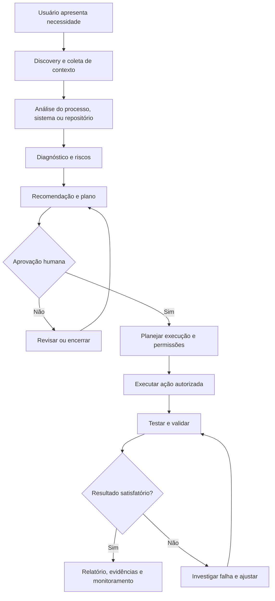
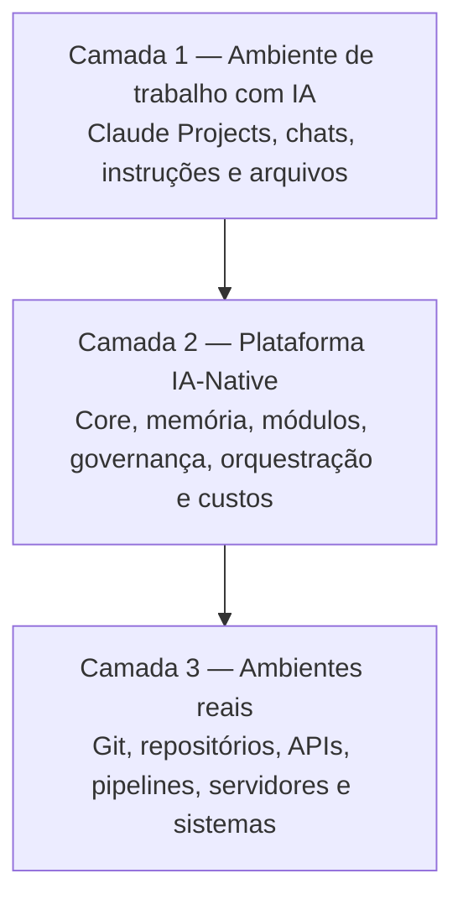
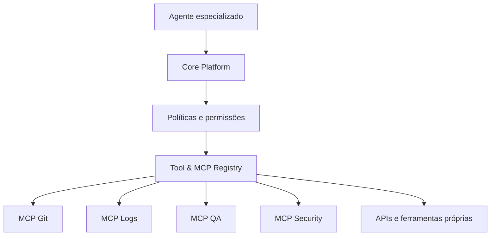

# IA-NATIVE — CONTEXTO MESTRE
## Visão do produto, arquitetura, organização do desenvolvimento e estratégia de integração
 
**Data:** 24/11/2026  
**Finalidade:** alimentar a IA Mestre responsável por modelar e coordenar o projeto.  
**Status:** visão estratégica e conceitual. A estrutura multiempresa/multiprojeto foi aceita pelo fundador; decisões técnicas específicas permanecem abertas.
 
> **Regra de leitura:** este documento diferencia ideias do fundador, análises, propostas, direção conceitual aceita e decisões técnicas pendentes. Não transforme propostas em decisões aprovadas sem validação. Não invente estatísticas, custos, requisitos ou capacidades. Preserve a visão original e explique riscos, alternativas e trade-offs.
 
# 1. Visão central
 
O IA-Native pretende ser uma plataforma modular, AI-Native, para engenharia de software, automação empresarial, inteligência operacional e validação/construção de negócios digitais.
 
A plataforma deve entender necessidades, descobrir processos e sistemas, estruturar soluções, organizar contexto, coordenar agentes e ferramentas, executar ações autorizadas, validar resultados e registrar evidências, decisões e custos.
 
Não deve ser apenas chatbot, gerador de código, RPA ou construtor de workflows. O diferencial deve estar na integração entre descoberta, planejamento, engenharia, execução, governança, memória e inteligência operacional.
 
**Tese central:** uma plataforma AI-Native que entende problemas, descobre processos, estrutura soluções, coordena especialistas humanos e agentes de IA, executa ações autorizadas, valida resultados e aprende com a operação — desde a primeira ideia até sistemas empresariais em produção.
 
Princípio: **Construir para usar. Usar para validar. Validar para melhorar. Melhorar para comercializar.**
 
A própria operação do fundador deve ser o primeiro laboratório real da plataforma.
 
# 2. Decisão conceitual aceita: plataforma multiempresa e multiprojeto
 
O fundador concordou que a estrutura central do produto deve ser:
 
**Uma plataforma multiempresa, com múltiplos projetos por empresa e módulos contratados independentemente por projeto.**
 
Essa direção deve orientar a modelagem do Core Platform.
 
```text
IA-NATIVE — PLATAFORMA
│
├── ORGANIZAÇÃO / CLIENTE
│   ├── Usuários e equipes
│   ├── Plano/contrato, orçamento e faturamento
│   ├── Políticas e configurações organizacionais
│   │
│   ├── PROJETO A
│   │   ├── Contexto próprio
│   │   ├── Repositórios e integrações
│   │   ├── Ambientes DEV / QA / PROD
│   │   ├── Permissões e limites
│   │   └── Módulos habilitados
│   │
│   ├── PROJETO B
│   │   └── Contexto, repositórios, permissões e módulos próprios
│   └── PROJETO C...
│
└── SERVIÇOS COMPARTILHADOS
    ├── Identidade e acesso
    ├── Memória e contexto
    ├── Orquestração
    ├── Model Router
    ├── Custos e medição
    ├── Auditoria
    └── Catálogo de ferramentas
```
 
Exemplo ilustrativo de contratação:
 
| Organização/projeto | Módulos habilitados |
|---|---|
| Empresa A — Projeto A | Git + Logs + Security |
| Empresa A — Projeto B | Git + QA |
| Empresa A — Projeto C | Backend + Frontend + QA + Security |
| Empresa B — Projeto X | Logs + Workflow + Integration |
 
A plataforma deve verificar contrato/acesso da organização, módulo habilitado no projeto, permissão do usuário, orçamento/limites e políticas aplicáveis.
 
## 2.1 Isolamento e escopos de contexto
 
Devem existir níveis distintos:
 
1. **Global da plataforma:** visão, arquitetura, padrões e governança comuns.
2. **Organização:** políticas, equipes, sistemas e informações compartilhadas autorizadas da empresa.
3. **Projeto:** requisitos, arquitetura, repositórios, decisões, módulos e histórico específico.
4. **Domínio/módulo:** conhecimento e estado específico de Git, Logs, IA Memory, QA etc.
5. **Execução/tarefa:** objetivo, entradas, ferramentas, aprovações, estado, resultados e evidências.
O contexto de uma organização não pode vazar para outra. O contexto de um projeto não deve ser compartilhado com outro sem regra explícita e autorização. O isolamento deve ser aplicado tecnicamente, não depender apenas de instruções em chats.
 
# 3. As quatro frentes de negócio
 
## Frente 1 — Automação e Inteligência Operacional
 
Ferramenta para avaliar processos, sistemas e operações. Coleta contexto, analisa evidências, identifica oportunidades, recomenda ações e, após aprovação, executa automações e valida resultados.
 
O cliente pode contratar módulos isolados: análise de logs, Git Intelligence, revisão de código, APIs, processos, workflows, integrações, monitoramento, testes, segurança ou arquitetura.
 

 
Princípios: diagnóstico antes de execução; evidências; aprovação humana para ações relevantes; menor privilégio; auditoria; limites de custo; critérios de aceite; cancelamento e rollback quando aplicável.
 
## Frente 2 — Dev House IA / AI-Native Software House
 
Plataforma para transformar ideias e necessidades em software com agentes especializados. Uma pessoa pode assumir papel de responsável pelo produto/CTO, mantendo decisões e aprovações sem dominar todas as especialidades técnicas.
 
Possibilidades: validar ideia, criar requisitos e arquitetura, protótipo, somente frontend, somente backend, APIs, aplicação completa, testes, revisão, modernização, implantação e operação.
 
Dois modelos:
1. Serviço prestado pela nossa operação, com profissionais apoiados pela plataforma.
2. Plataforma self-service, na qual o cliente escolhe módulos e conduz seu projeto com agentes.
Não deve ser apenas gerador de código. Deve ajudar a decidir o que construir, por quê, em que ordem, com qual investimento, riscos e critérios de sucesso.
 
## Frente 3 — Enterprise Process Automation & Integration
 
Atender empresas com CRM, ERP, WMS, e-commerce, sistemas financeiros, plataformas internas e serviços externos. O objetivo não é substituir os sistemas por padrão, mas compreender processos e conectar, automatizar ou melhorar o que já existe.
 
Exemplos: integração CRM/ERP; pedidos de e-commerce e estoque; sincronização de clientes, produtos e faturamento; aprovações; conciliação; exceções; relatórios; APIs; RPA quando não houver integração adequada; logs e modernização gradual.
 
Respeitar arquitetura e segurança existentes. Não alterar autenticação, autorização ou governança sem autorização. A operação comercial pode ser liderada por equipe especializada, separada da equipe que mantém a plataforma, sem duplicar o Core.
 
## Frente 4 — Idea-to-Business
 
Plataforma para ajudar quem tem uma ideia a avaliar se vale investir, validar problema e mercado, estruturar negócio, planejar finanças, preparar pitch e, quando fizer sentido, construir protótipo ou produto.
 
Referências citadas pelo fundador como possíveis fontes de conceitos:
- *A Startup Enxuta*, Eric Ries;
- conceitos de Smart Money associados a João Kepler;
- validação de problema e mercado;
- proposta de valor;
- modelo de negócio;
- planejamento financeiro;
- pitch e entrada no mercado.
As metodologias devem ser pesquisadas e adaptadas ao caso; não são receitas universais.
 
Capacidades: capturar ideia; identificar problema e público; pesquisar concorrentes; estruturar proposta de valor; identificar hipóteses e riscos; planejar entrevistas e experimentos baratos; estimar custos; criar cenários financeiros; elaborar modelo de negócio e pitch; recomendar MVP; encaminhar para Dev House; atualizar plano com evidências.
 
**Hipótese de mercado:** pessoas e empresas gastam recursos desenvolvendo apps, serviços e plataformas antes de validar demanda. O IA-Native pode reduzir desperdício, mas o plano de negócios precisa quantificar isso com fontes confiáveis. Não inventar estatísticas nem prometer que a IA impedirá fracassos.
 
# 4. Claude Projects e IA-Native: complementaridade
 
O fundador usa Claude Projects e considera um projeto principal IA-Native com chats especializados, contexto compartilhado e repositórios locais conectados para trabalhar em branches.
 
Claude Projects pode organizar instruções, arquivos, contexto de trabalho, conversas especializadas e desenvolvimento assistido. Mas organizar chats manualmente não resolve, por si só, a operação comercial multiempresa/multiprojeto, com isolamento, contratos, permissões, custos e governança.
 
| Claude Projects / ambiente de IA | Plataforma IA-Native |
|---|---|
| Organiza conversas e contexto de trabalho | Organiza organizações, projetos e módulos |
| Instruções e arquivos de referência | Governança aplicada a agentes e ferramentas |
| Apoia desenvolvimento | Coordena ciclo de engenharia e operação |
| Usa ferramentas disponíveis | Gerencia catálogo, permissões e integrações |
| Contexto de projeto de trabalho | Memória estruturada, versionada e isolada |
| Plano/limites do fornecedor | Medição por cliente, projeto, módulo e execução |
 
**Conclusão:** não construir um substituto do Claude. Usar Claude como ambiente de engenharia e potencial provedor de modelos; construir a camada de produto, operação, integração, governança, memória, isolamento e comercialização que não deve depender de uma coleção de chats.
 
## 4.1 Três camadas
 

 
- Camada 1: ambiente usado pelo fundador/equipe para pensar, modelar e desenvolver.
- Camada 2: produto próprio, responsável por organizações, projetos, módulos, políticas, orquestração, custos e experiência.
- Camada 3: sistemas onde o trabalho acontece de fato.
# 5. Organização dos chats do projeto Claude
 
Organizar chats por **domínio de responsabilidade**, não por cada pequena funcionalidade. Proposta de nomes:
 
**Arquitetura e plataforma**
- `00 — Arquitetura & Governança`
- `01 — Core Platform`
- `02 — IA Memory & Context`
- `03 — AI Harness & Orchestration`
- `04 — Model Router & AI Cost`
**Engenharia**
- `05 — Git & Repository Intelligence`
- `06 — Backend Engineering`
- `07 — Frontend & UX Engineering`
- `08 — QA & Testing`
- `09 — Security Engineering`
- `10 — DevOps & Infrastructure`
- `11 — Logs & Observability`
**Produto e negócio**
- `12 — Process Discovery & Blueprint`
- `13 — Workflow & Integrations`
- `14 — Product & Business Strategy`
- `15 — Idea-to-Business`
Não criar todos imediatamente. Criar quando houver responsabilidade e trabalho real.
 
Responsabilidades:
- **00 Arquitetura & Governança:** visão global, padrões, decisões, fronteiras e contratos. Não desenvolve todos os módulos.
- **01 Core:** organizações, usuários, projetos, módulos, permissões e APIs centrais.
- **02 IA Memory:** memória, recuperação, indexação, continuidade e contexto por escopo.
- **03 Orchestration:** agentes, planejamento, tarefas, estado, dependências, retries, handoffs e aprovações.
- **04 Model Router & Cost:** modelos, provedores, fallback, custo, orçamento e métricas.
- **05 Git:** repositórios, branches, commits, diffs, PR/MR e risco de mudanças.
- **06 Backend:** serviços, APIs, domínio e persistência.
- **07 Frontend:** UX, design system, componentes e acessibilidade.
- **08 QA:** testes unitários, integração, E2E, regressão e qualidade.
- **09 Security:** aplicação, APIs, infraestrutura, agentes e DevSecOps.
- **10 DevOps:** CI/CD, containers, ambientes, deploy, rollback e infraestrutura.
- **11 Logs:** logs, métricas, traces, alertas, incidentes e causa raiz.
- **12 Discovery & Blueprint:** processos, AS-IS/TO-BE, requisitos e rastreabilidade.
- **13 Workflow:** APIs, n8n, Temporal, Camunda, RPA e integrações.
- **14 Product & Business:** frentes, mercado, precificação e posicionamento.
- **15 Idea-to-Business:** validação, modelo de negócio, pitch e MVP.
# 6. Contextos compartilhados e individuais
 
O fundador pediu explicitamente para separar o contexto geral, compartilhado por todos os chats, do contexto específico de cada domínio.
 
## 6.1 Contexto global compartilhado
- visão e objetivos do IA-Native;
- princípios arquiteturais;
- padrões de código e tecnologias aprovadas;
- modelo de dados global;
- contratos e APIs entre módulos;
- segurança e governança;
- nomenclatura;
- decisões arquiteturais aprovadas;
- convenções Git;
- documentação e testes.
## 6.2 Contexto individual de domínio
- Git: branches, operações, integrações e análise.
- IA Memory: estrutura, recuperação, indexação e avaliação.
- Logs: ingestão, correlação, retenção e diagnóstico.
- Security: threat modeling, controles e verificações.
- Backend: serviços e regras.
- Frontend: componentes, UX, design system.
- QA: estratégia e automação de testes.
## 6.3 Contexto de organização e projeto
Cada cliente/projeto possui regras de negócio, sistemas, arquitetura, repositórios, equipes, permissões, módulos, ambientes, decisões e orçamento próprios.
 
```text
IA-NATIVE
├── Contexto global
│   ├── Arquitetura
│   ├── Padrões
│   ├── Segurança
│   └── Governança
├── Domínios
│   ├── Git
│   ├── IA Memory
│   ├── Logs
│   ├── Backend
│   └── QA
└── Clientes e projetos
    ├── Empresa A
    │   ├── Projeto A (contexto, repo, módulos)
    │   └── Projeto B (contexto, repo, módulos)
    └── Empresa B
        └── Projeto X (contexto, repo, módulos)
```
 
O compartilhamento entre projetos da mesma organização deve ser explícito e autorizado. O isolamento entre organizações é obrigatório.
 
# 7. Integração dos módulos e contratos
 
Os chats especializados não devem desenvolver código isolado e tentar encaixar tudo no final. Cada domínio pode evoluir internamente, mas deve respeitar contratos compartilhados.
 
| Domínio | Responsabilidade | Entrega aos demais |
|---|---|---|
| Core | Identidade e estrutura | APIs e modelo organização/projeto |
| IA Memory | Memória e contexto | Interfaces de gravação/recuperação |
| Git | Inteligência de repositórios | Eventos, análises e resultados |
| Logs | Observabilidade | Eventos, alertas e diagnósticos |
| Security | Controles e avaliação | Políticas, resultados e gates |
| QA | Qualidade | Resultados e critérios de aprovação |
 
Contratos devem especificar responsabilidade, entradas/saídas, APIs/eventos, dados, autenticação/autorização, erros, versionamento, observabilidade, testes e compatibilidade.
 
## 7.1 Repositório e Git
 
Proposta inicial: avaliar um repositório principal organizado por módulos, sem criar um repositório por chat automaticamente.
 
```text
ia-native/
├── docs/
│   ├── vision/
│   ├── architecture/
│   ├── decisions/
│   └── standards/
├── core/
├── modules/
│   ├── ai-memory/
│   ├── git-intelligence/
│   ├── log-intelligence/
│   ├── security/
│   ├── qa/
│   └── workflow-integration/
├── services/
├── integrations/
├── frontend/
├── infrastructure/
└── tests/
```
 
Branches ilustrativas:
```text
main
├── feature/core-organization-projects
├── feature/ai-memory-foundation
├── feature/git-intelligence
├── feature/log-intelligence
├── feature/security-foundation
└── feature/workflow-adapters
```
 
Cada domínio trabalha em branch com escopo claro; integração via PR/MR, testes, revisão e aprovação. Monorepo é hipótese inicial, não decisão fechada. Comparar com multirepo considerando deploy independente, equipes, dependências, versionamento, permissões e build.
 
O repositório é a fonte da verdade do código. A memória da IA não substitui código, documentação versionada ou decisões registradas.
 
# 8. MCP e integrações
 
MCP deve ser uma camada de integração de ferramentas, não um módulo de negócio.
 
Exemplos:
- agente Git opera repositórios;
- agente Logs consulta observabilidade;
- agente QA executa testes;
- agente Security consulta scanners;
- outros agentes usam APIs e ferramentas internas.
Proposta: **Tool & MCP Registry**, registrando ferramentas, agentes autorizados, organizações/projetos com acesso, permissões, credenciais, limites, aprovações e auditoria.
 

 
Não criar MCP para tudo. API direta pode ser mais simples. Usar MCP quando melhorar interoperabilidade entre modelos, agentes e ferramentas.
 
# 9. Claude, APIs de modelos e custos
 
Separar:
1. Claude como ferramenta de desenvolvimento do fundador/equipe, respeitando limites e termos do plano.
2. Claude como provedor de IA via API, conforme contrato e condições.
3. IA-Native como produto comercial, com módulos, planos e consumo definidos pela plataforma.
Não presumir que uma assinatura individual permite revender acesso, compartilhar credenciais ou operar um serviço comercial. Planos de usuário e APIs são modalidades diferentes e devem respeitar os termos do fornecedor.
 
O Model Router seleciona modelos por tarefa, complexidade, custo, qualidade, latência, disponibilidade, privacidade, contexto e fallback.
 
Medir custo por organização, projeto, módulo e execução. Considerar tokens, infraestrutura, orquestração, armazenamento, integrações, revisão humana, retries e suporte. Criar limites, orçamentos, alertas, timeout, cancelamento e prevenção de loops.
 
# 10. Core Platform — capacidades propostas
 
1. **Identity & Organization Management:** organizações, usuários, equipes, papéis, autenticação, autorização e isolamento.
2. **Project & Module Management:** projetos, repositórios, ambientes, módulos habilitados, configurações e limites.
3. **IA Memory & Context:** memória global, organização, projeto, domínio e execução; origem, confiança, versão e recuperação.
4. **Agent Harness & Orchestration:** planejamento, seleção de agentes, execução, estado, dependências, retries, handoffs, aprovações e cancelamento.
5. **Model Router:** múltiplos fornecedores, seleção, fallback e políticas por tarefa.
6. **AI Cost Intelligence:** chamadas, tokens, custos, orçamento, alertas, previsão e margem.
7. **Governance & Audit:** políticas, menor privilégio, aprovação, auditoria, retenção e privacidade.
8. **Tool & MCP Registry:** ferramentas, conectores, MCPs, credenciais e permissões.
9. **Execution Monitor:** tarefas, agentes, estado, custos, aprovações, bloqueios, evidências e resultados.
# 11. n8n, Temporal e Camunda
 
O fundador perguntou se seria necessário usar ferramentas de APIs e workflows como n8n, Temporal e Camunda, considerando também os custos.
 
| Tecnologia | Papel | Potencial uso | Atenção |
|---|---|---|---|
| n8n | Workflows visuais e integrações | Conectores, APIs, automações rápidas e protótipos | Licença, embedding, distribuição, credenciais, escala e governança |
| Temporal | Workflows duráveis por código | Processos longos, retries, estado persistente e execução distribuída | Operação técnica e desenho de workflows |
| Camunda | Processos BPMN/DMN | Tarefas humanas, regras, auditoria e governança | Complexidade, edição, licenciamento e TCO |
 
Não são substitutos diretos. Não há decisão de adotar os três.
 
Recomendação: começar com executor simples e controlado para tarefas curtas; chamar APIs diretamente quando simples; experimentar n8n quando acelerar integrações; adotar Temporal se houver workflows longos/duráveis/distribuídos; avaliar Camunda se BPMN, tarefas humanas e governança forem requisitos fortes.
 
Antes de comercializar/incorporar ferramentas, revisar licença exata, edição, uso comercial, hospedagem, embedding, redistribuição e obrigações.
 
# 12. Segurança como diferencial e responsabilidade transversal
 
Security Engineering deve ser domínio especializado; Security Governance deve aplicar regras a todos os módulos.
 
Tópicos a desenvolver: secure coding, SQL Injection, XSS, CSRF, validação de entrada, autenticação/autorização, OAuth 2.0, OpenID Connect, JWT quando adequado, MFA, RBAC/ABAC, APIs, rate limiting, criptografia, segredos, proteção de dados, hardening, containers/Kubernetes, redes, firewalls, TLS, OWASP Top 10, DDoS, backups, SAST/DAST/SCA, DevSecOps, threat modeling, vulnerabilidades, incidentes, prompt injection e segurança de agentes.
 
Segurança básica sempre incluída. Assessment aprofundado e monitoramento contínuo podem ser serviços adicionais. Respeitar controles já existentes no cliente.
 
# 13. Process Discovery & Blueprint Engineering
 
A ideia de Angelo evoluiu para uma capacidade de engenharia anterior à execução.
 
Nome conceitual: **Software Process Discovery & Blueprint Engineering**.
 
Etapas:
1. Entender necessidade e resultado de negócio.
2. Descobrir AS-IS e TO-BE.
3. Mapear atores, atividades, eventos, entradas/saídas, regras, exceções, sistemas e dependências.
4. Estruturar subprocessos e fluxos alternativos.
5. Produzir requisitos funcionais e não funcionais.
6. Criar Blueprint versionado com arquitetura, módulos, integrações, dados, riscos e decisões.
7. Validar com responsável humano.
8. Gerar backlog e plano.
9. Executar por agentes/profissionais.
10. Testar, revisar, entregar e operar.
11. Atualizar Blueprint conforme mudanças.
Rastreabilidade:
```text
Necessidade → Processo → Requisito → Arquitetura → Tarefa → Código → Teste → Entrega → Operação
```
 
Separar informação confirmada, extraída, inferida, hipótese, decisão pendente e decisão aprovada. A IA não pode transformar hipótese em regra confirmada.
 
# 14. Segurança operacional dos agentes
 
Agentes podem alterar código, dados, infraestrutura e sistemas empresariais. Portanto, considerar:
- permissões mínimas;
- sandbox;
- aprovação humana;
- auditoria;
- limites de custo e execução;
- separação de ambientes;
- rollback;
- credenciais protegidas;
- prevenção de vazamento entre clientes;
- políticas contra prompt injection e uso indevido de ferramentas.
A autonomia deve crescer com evidência, controles e maturidade; não deve ser presumida.
 
# 15. Riscos e pontos de atenção
 
1. Escopo excessivo: quatro frentes simultâneas podem dispersar recursos; começar com fluxo vertical.
2. Reinventar ferramentas: integrar Claude e ferramentas maduras quando fizer sentido.
3. Dependência de chats: chats não substituem memória, governança e isolamento do produto.
4. Contexto misturado: separar global, organização, projeto, domínio e execução.
5. Agentes sem controle: menor privilégio, sandbox, aprovação, auditoria, limites e rollback.
6. Discovery incompleto: registrar origem, confiança, hipóteses e validações.
7. Dependência de fornecedor: suportar múltiplos modelos sem abstração excessiva.
8. Excesso de ferramentas: não adotar n8n, Temporal e Camunda sem necessidade.
9. Segurança opcional: baseline sempre incluído.
10. Produto confundido com consultoria: separar plataforma, módulos, serviços e customizações.
11. Falsa confiança na validação: exigir evidências reais.
12. Custos desconhecidos: medir economia unitária desde protótipos.
13. Monorepo versus multirepo: ainda precisa ser avaliado.
14. MCP em excesso: API direta pode ser melhor em alguns casos.
# 16. Estratégia de implementação sugerida
 
**Etapa 1 — Definir o produto:** organização/projeto/módulo, isolamento, usuários, permissões, contratação e limites.
 
**Etapa 2 — Core mínimo:** identidade, organizações/projetos, contexto, auditoria, autorização, medição de custos e execução controlada.
 
**Etapa 3 — Primeiro fluxo vertical:**
1. receber necessidade;
2. fazer Discovery;
3. gerar Blueprint;
4. propor tarefas;
5. solicitar aprovação;
6. executar ação autorizada;
7. testar;
8. apresentar evidências e custos.
**Etapa 4 — Módulos reutilizáveis:** priorizar Git, IA Memory, Logs, Security, QA, Backend, Frontend etc. conforme primeiro caso de uso.
 
**Etapa 5 — Primeira oferta comercial:** público, problema, resultado, preço, limites e suporte.
 
**Etapa 6 — Expandir as quatro frentes** conforme demanda e capacidade.
 
# 17. Documentos de contexto que deverão ser criados
 
O fundador pediu para separar os contextos gerais e compartilhados dos individuais. A proposta inicial:
 
- `GLOBAL_CONTEXT.md` — visão, arquitetura, padrões, tecnologias aprovadas, nomenclatura, segurança, governança, contratos comuns e convenções Git.
- `DOMAIN_CONTEXT.md` — responsabilidade, escopo, arquitetura interna, tecnologias, decisões, backlog, APIs, testes e pendências de cada domínio.
- `ARCHITECTURE_DECISIONS.md` — decisões, status, contexto, alternativas, justificativa, consequências, data e módulos afetados.
Documentos adicionais possíveis:
- `PRODUCT_VISION.md`;
- `MODULE_CATALOG.md`;
- `INTEGRATION_CONTRACTS.md`;
- `SECURITY_BASELINE.md`;
- `COST_MODEL.md`;
- `CUSTOMER_CONTEXT_TEMPLATE.md`.
Não criar tudo de uma vez. Começar pelo mínimo e evoluir.
 
# 18. Próximos passos no Claude
 
1. Revisar o contexto global.
2. Definir fronteiras e responsabilidades dos domínios.
3. Criar `00 — Arquitetura & Governança`.
4. Criar chats de Core, IA Memory, Git e demais módulos conforme prioridade.
5. Preparar instruções e documentos de cada domínio.
6. Conectar repositório e estabelecer branches/PRs.
7. Avaliar MCPs e integrações necessárias.
Não abrir todos os chats antes de definir responsabilidades, contratos e contexto compartilhado.
 
# 19. Backlog estratégico
 
| ID | Item | Objetivo | Situação conceitual |
|---|---|---|---|
| IA-001 | Multi-organization / Multi-project Core | Organizações, projetos e módulos | Direção aceita |
| IA-002 | Identity & Access | Usuários, equipes, papéis e permissões | Proposto |
| IA-003 | Project & Module Management | Habilitação por projeto | Proposto |
| IA-004 | Global Context | Contexto compartilhado | Necessário |
| IA-005 | IA Memory & Context | Memória por escopo | Prioritário a detalhar |
| IA-006 | AI Harness & Orchestration | Coordenação de agentes | Proposto |
| IA-007 | Model Router | Modelos e fallback | Proposto |
| IA-008 | AI Cost Intelligence | Custos e orçamento | Prioritário |
| IA-009 | Governance & Audit | Políticas, aprovações e auditoria | Essencial |
| IA-010 | Tool & MCP Registry | Ferramentas e permissões | A avaliar |
| IA-011 | Git Intelligence | Repositórios, branches, commits, PR/MR | Proposto |
| IA-012 | Log Intelligence | Logs e incidentes | Proposto |
| IA-013 | Security Engineering | Segurança especializada | Essencial |
| IA-014 | Security Governance | Políticas transversais | Essencial |
| IA-015 | QA & Testing | Testes e gates | Proposto |
| IA-016 | Backend Engineering | Serviços e APIs | Proposto |
| IA-017 | Frontend & UX | Interface e design | Proposto |
| IA-018 | DevOps & Infrastructure | CI/CD e operação | Proposto |
| IA-019 | Process Discovery & Blueprint | Descoberta e desenho | Diferencial |
| IA-020 | Workflow Integrations | n8n, Temporal, Camunda e APIs | A avaliar |
| IA-021 | Enterprise Automation | Integração empresarial | Frente comercial |
| IA-022 | Idea-to-Business | Validação e planejamento | Frente futura |
| IA-023 | Commercial Packaging | Planos e módulos | Necessário |
| IA-024 | Unit Economics | Custo real e margem | Necessário |
| IA-025 | Architecture Decisions Registry | Histórico de decisões | Necessário |
| IA-026 | Integration Contracts | Contratos entre domínios | Necessário |
 
# 20. Decisões e perguntas em aberto
 
1. Qual será o primeiro caso de uso vertical?
2. Qual módulo será primeiro desenvolvido e usado internamente?
3. Qual o modelo de dados inicial para organização, projeto, módulo, usuário e execução?
4. Como será o isolamento técnico entre organizações/projetos?
5. Como compartilhar contexto entre projetos da mesma organização?
6. Monorepo ou multirepo?
7. Quais tecnologias serão adotadas no Core?
8. Qual primeiro provedor/modelo de IA?
9. Qual nível de abstração do Model Router?
10. Qual primeiro motor de workflow?
11. Quais integrações exigirão MCP e quais serão API direta?
12. Quais ações exigirão aprovação humana?
13. Como será o modelo comercial de módulos e consumo?
14. Como suportar DEV, QA e PROD?
15. Como clientes conectarão repositórios e credenciais com segurança?
16. Como provisionar organizações, projetos e módulos?
17. Como calcular orçamento, limites e custo por projeto?
18. Qual será a primeira frente comercial?
# 21. Instruções para a IA Mestre
 
1. Preservar a visão do fundador e as quatro frentes.
2. Tratar a estrutura multiempresa/multiprojeto com módulos por projeto como direção conceitual aceita.
3. Não confundir Claude Projects com o produto IA-Native.
4. Não substituir Claude sem necessidade; considerar integração e independência de fornecedor.
5. Distinguir contexto global, organização, projeto, domínio e execução.
6. Proteger isolamento entre clientes e projetos.
7. Definir fronteiras e contratos antes de desenvolver módulos em paralelo.
8. Não tratar chats como fonte definitiva de memória ou arquitetura.
9. Manter código, documentação e decisões versionados.
10. Não criar MCP para tudo; avaliar API direta por caso de uso.
11. Não adotar n8n, Temporal e Camunda simultaneamente sem justificativa.
12. Medir custos desde os protótipos.
13. Incluir segurança básica em todas as frentes.
14. Exigir aprovação para ações relevantes, destrutivas, financeiras, externas ou de alto risco.
15. Não inventar estatísticas de mercado ou estimativas.
16. Apresentar alternativas, trade-offs e riscos.
17. Identificar o que é ideia, proposta, direção aceita ou pendência.
18. Explicar impacto em prazo, custo e complexidade antes de ampliar escopo.
19. Priorizar um fluxo vertical real.
20. Manter o contexto evolutivo, versionado e coerente com decisões futuras.
# 22. Conclusão
 
A visão vai além de organizar chats ou automatizar tarefas isoladas. É construir uma plataforma capaz de atender desde uma pessoa com uma ideia até uma empresa com diversos sistemas, projetos, equipes e processos.
 
A decisão conceitual mais importante desta etapa foi aceitar uma estrutura **multiempresa, multiprojeto e modular**, na qual cada projeto pode habilitar módulos diferentes, enquanto a plataforma compartilha identidade, memória, governança, orquestração, custos e integração.
 
Claude Projects continuará útil como ambiente de trabalho e desenvolvimento. Não precisamos competir com ele em organização de conversas. O IA-Native deve resolver a camada necessária para transformar capacidades de IA em uma operação estruturada, governada, mensurável e comercializável.
 
A organização dos chats por domínio permitirá desenvolvimento separado, mas a integração depende de contratos, padrões, documentação versionada e arquitetura coerente. A memória compartilhada deve ser capacidade do produto, não apenas lembrança informal entre conversas.
 
MCP, n8n, Temporal, Camunda, Git e outras ferramentas devem ser integrados quando agregarem valor. Não reconstruir ferramentas maduras sem razão estratégica nem adicionar dependências antes de existir um caso de uso.
 
O maior risco atual não é falta de ideias: é tentar executar todas ao mesmo tempo. O caminho é definir o Core mínimo, escolher um fluxo vertical, desenvolver os primeiros módulos usando a própria plataforma, medir custos, validar na prática e expandir.
 
**Visão final:** permitir que uma pessoa ou organização transforme uma necessidade em processo compreendido, solução planejada e execução governada — usando módulos especializados, agentes de IA e ferramentas existentes, com controle humano, segurança, rastreabilidade e custos transparentes.
 
**Construir para usar. Usar para validar. Validar para melhorar. Melhorar para comercializar.**
 
**Fim do documento.**
 