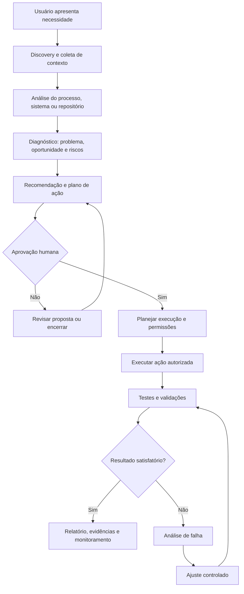
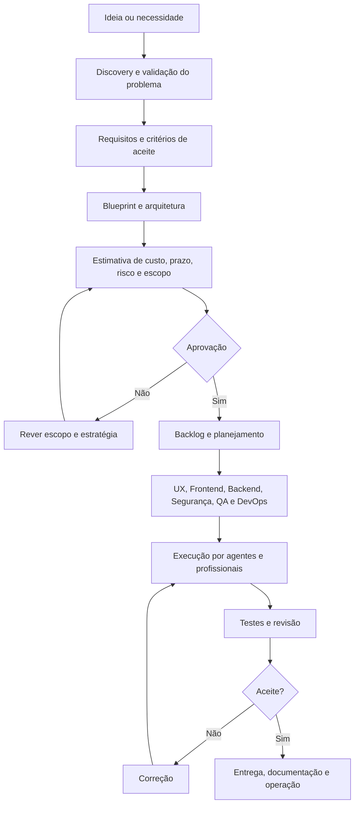
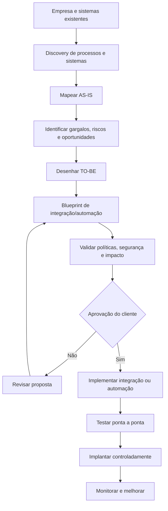
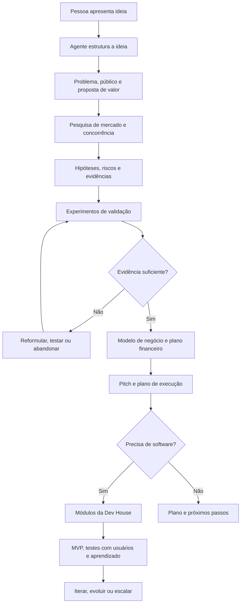
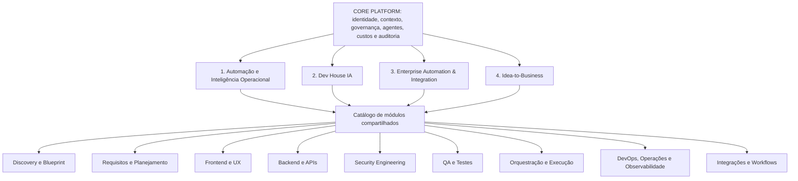
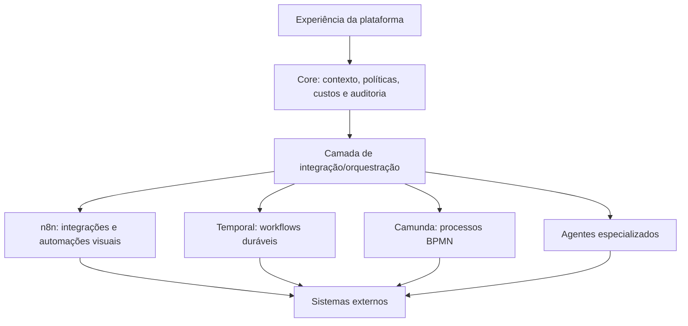

# Estratégia da Plataforma AI-Native
## Consolidação de visão, arquitetura, frentes de negócio, automação e plano de evolução
 
**Data:** 24 de novembro de 2026  
**Status:** documento estratégico de trabalho; propostas precisam de validação antes de se tornarem decisões técnicas.
 
> **Nota de fidelidade:** este documento consolida o histórico e o contexto recuperáveis desta conversa. Não é uma transcrição literal integral: nem todas as respostas anteriores estão disponíveis aqui em seu texto original. Não vou atribuir como citação literal frases que não consigo verificar. As ideias recuperáveis foram preservadas; os desenvolvimentos novos estão identificados como recomendações ou hipóteses.
 
# 1. Objetivo
 
Reunir os insights discutidos sobre uma plataforma AI-Native para engenharia de software, automação empresarial e validação/construção de negócios digitais. O documento deve alimentar a IA que modelará o projeto, preservar a visão e apoiar arquitetura, backlog, custos, estratégia comercial e evolução.
 
# 2. Origem: automação como engenharia, não apenas execução
 
A conversa começou com uma ideia apresentada por Angelo Cunhado:
 
> “gerei isso pra vc entender como penso em automação”
 
A essência era orientar Claude a atuar como **Senior Process Analyst + Automation Developer** e, antes de gerar código, validar se a automação faz sentido e identificar riscos.
 
A IA não deve simplesmente entrar em um sistema e clicar como um robô. Deve atuar como engenheira de automação:
 
1. Entender o problema e o resultado esperado.
2. Analisar o processo atual.
3. Identificar regras, exceções, dependências e riscos.
4. Avaliar se automatizar é a melhor solução.
5. Propor e documentar o desenho.
6. Solicitar aprovação quando necessário.
7. Implementar ou coordenar a implementação.
8. Testar.
9. Investigar falhas, corrigir e testar novamente.
10. Acompanhar resultados e aprender com a operação.
A automação passa a ser uma disciplina de descoberta, análise, desenho, validação, implementação e melhoria contínua.
 
## 2.1 Blue Prism, Blueprint e a ideia de Angelo
 
- **Blue Prism (SS&C Blue Prism):** plataforma empresarial de RPA e automação inteligente, com capacidades relacionadas a descoberta/modelagem de processos, trabalhadores digitais, orquestração, governança e execução.
- **Abordagem de Angelo:** método de engenharia de automação assistido por IA. A IA analisa, valida, desenha, gera artefatos e prepara a automação; ferramentas autorizadas realizam a execução.
- **Blueprint:** artefato estruturado de desenho/planejamento da solução; não é a mesma coisa que Blue Prism.
São conceitos relacionados, mas não equivalentes. Blue Prism pode ser referência de capacidades e princípios, sem que seja necessário copiar sua arquitetura ou adotar seu produto. A abordagem de Angelo é particularmente relevante para empresas com sistemas e processos existentes, mas também serve para descoberta e engenharia de novos softwares.
 
# 3. Visão maior: One-Person AI-Native Software House
 
A possibilidade é criar uma **One-Person AI-Native Software House**: uma operação em que uma pessoa assume visão de negócio, arquitetura, decisões e responsabilidade, enquanto agentes especializados apoiam diferentes funções.
 
Capacidades especializadas:
- análise de negócio e descoberta de processos;
- arquitetura de solução;
- engenharia de requisitos;
- planejamento;
- backend;
- frontend e UX;
- segurança;
- QA e testes;
- DevOps e entrega;
- operações e manutenção;
- automação e integração empresarial.
A pessoa continua responsável pelas decisões, aprovações e direção. Agentes não devem ter autonomia irrestrita: suas ações respeitam permissões, políticas, limites de custo, contexto e pontos de aprovação.
 
Possível evolução:
1. **One-Person AI-Native Software House:** usar a própria plataforma para entregar projetos e serviços.
2. **AI-Native Software House escalável:** atender vários clientes e projetos com agentes coordenados.
3. **Plataforma comercial:** vender tecnologia e módulos para outras pessoas, consultorias e software houses.
A própria operação deve ser o primeiro ambiente real de validação.
 
**Ciclo estratégico:** construir → usar → validar → melhorar → comercializar.
 
# 4. As quatro frentes de negócio
 
As quatro frentes devem ser ofertas comerciais distintas, apoiadas por uma base tecnológica comum. Não recomendamos construir quatro produtos independentes.
 
## Frente 1 — Automação e Inteligência Operacional
 
### Proposta
Uma ferramenta que qualquer pessoa ou empresa possa usar para avaliar processos, sistemas e operações. A plataforma investiga, coleta informações, analisa, identifica oportunidades e recomenda ações. Depois da aprovação do responsável, automatiza o que for apropriado, testa, investiga falhas, corrige e repete os testes.
 
O cliente pode contratar somente capacidades específicas:
- análise de logs;
- inteligência sobre Git;
- revisão de código;
- análise de APIs;
- análise de processos;
- automação de workflows;
- avaliação de integrações;
- monitoramento de falhas;
- testes;
- segurança;
- arquitetura.
### Fluxo proposto
 

 
Princípios:
- diagnóstico antes de execução;
- evidências antes de conclusões;
- aprovação humana para ações relevantes;
- permissões mínimas;
- registro de ações, resultados e custos;
- critérios de aceite explícitos;
- capacidade de interromper, reverter ou escalar;
- contratação modular.
Modelo comercial possível: assinatura por módulo, planos por volume, cobrança por execução/consumo, avaliações pontuais e contratos empresariais. Evitar tanto consumo ilimitado sem controle quanto cobrança imprevisível sem transparência.
 
## Frente 2 — Dev House IA / AI-Native Software House
 
### Proposta
Uma plataforma que permite a uma pessoa, empreendedor ou empresa desenvolver uma ideia de software com agentes especializados. O usuário pode assumir o papel de CTO, mesmo sem dominar todas as especialidades técnicas, mantendo controle sobre decisões e aprovações.
 
Possibilidades:
- validar uma ideia;
- transformar ideia em requisitos;
- desenhar arquitetura;
- criar protótipo;
- desenvolver somente frontend;
- desenvolver somente backend;
- criar APIs;
- desenvolver aplicação completa;
- testar e revisar;
- modernizar sistema existente;
- preparar implantação e operação.
Dois modelos:
1. **Serviço prestado pela nossa operação:** nossa equipe, apoiada pela plataforma, conduz descoberta, planejamento, desenvolvimento, testes e entrega.
2. **Plataforma self-service:** cliente escolhe módulos e conduz projeto com agentes; contrata apenas validação, frontend, backend ou ciclo completo.
### Fluxo
 

 
Diferencial: não ser apenas gerador de código. A plataforma ajuda a decidir **o que vale a pena construir**, em que ordem, com qual investimento, riscos e evidências de atendimento ao problema.
 
## Frente 3 — Enterprise Process Automation & Integration
 
### Proposta
Atender empresas que já possuem CRM, ERP, WMS, e-commerce, plataformas financeiras, sistemas internos e serviços de terceiros. O objetivo não é necessariamente substituir sistemas existentes, mas entender a operação, identificar gargalos e automatizar/integrar processos.
 
Exemplos:
- integração CRM e ERP;
- pedidos de e-commerce chegando ao estoque;
- sincronização de clientes, produtos e faturamento;
- automação de aprovações;
- conciliação de informações;
- tratamento de exceções;
- relatórios;
- integração por APIs;
- RPA quando não houver interface adequada;
- análise de logs e incidentes;
- modernização gradual.
A plataforma deve descobrir e respeitar controles, políticas, arquitetura e segurança existentes. Não substituir autenticação, autorização ou regras de governança sem autorização.
 
### Fluxo
 

 
A operação comercial pode ser separada por unidade/equipe. Angelo ou outras pessoas podem liderar essa frente, enquanto outra equipe desenvolve a plataforma. Isso permite especialização sem duplicar o Core Platform.
 
## Frente 4 — Idea-to-Business: validação de ideias e planejamento
 
### Proposta
Uma plataforma para quem tem uma ideia, mas não sabe se é viável, como validar, quanto investir, como apresentar ou como construir uma primeira versão.
 
O **Agente Planejador** seria um assistente de negócio altamente capacitado, combinando métodos de empreendedorismo, estratégia, validação e planejamento.
 
Referências citadas como possíveis fontes de conceitos:
- *A Startup Enxuta*, de Eric Ries;
- conceitos de Smart Money associados a João Kepler;
- pitch e apresentação para investidores;
- validação de problema e mercado;
- modelo de negócio;
- planejamento financeiro;
- estratégia de entrada no mercado.
As metodologias não devem ser tratadas como receitas universais. A plataforma seleciona ferramentas conforme estágio, negócio, mercado e evidências.
 
Capacidades:
1. Capturar a ideia em linguagem natural.
2. Identificar problema e resultado pretendido.
3. Identificar público-alvo e hipóteses de cliente.
4. Investigar concorrentes e alternativas.
5. Estruturar proposta de valor.
6. Identificar hipóteses críticas e riscos.
7. Criar experimentos baratos de validação.
8. Planejar entrevistas e pesquisas.
9. Estimar custos iniciais e recorrentes.
10. Construir cenários financeiros.
11. Elaborar modelo de negócio.
12. Criar pitch e apresentação.
13. Recomendar MVP ou protótipo.
14. Encaminhar para módulos da Dev House.
15. Acompanhar evidências e atualizar o plano.
### Fluxo
 

 
### Oportunidade econômica
Existe uma hipótese comercial importante: pessoas e empresas podem gastar dinheiro desenvolvendo apps, plataformas e serviços antes de comprovar demanda. Alguns projetos são abandonados ou não chegam a gerar valor.
 
A plataforma pode reduzir desperdício ao testar hipóteses antes de comprometer grandes quantias com desenvolvimento.
 
**Essa hipótese precisa ser quantificada no plano de negócios.** Pesquisar fontes confiáveis sobre:
- sobrevivência e mortalidade de empresas/startups;
- motivos de fracasso;
- gastos médios com desenvolvimento e MVP;
- custo de projetos digitais abandonados;
- marketing antes da validação;
- custo de oportunidade de equipes e fundadores;
- diferenças por setor e país;
- projetos que falham por demanda, execução, financiamento ou outros fatores.
Não inventar um número de dinheiro desperdiçado. Não prometer que a IA impedirá fracassos. Vender redução de incerteza, experimentos mais baratos, escopo claro e melhor alocação de capital.
 
Receita possível: validação de ideia, plano de negócio, pitch, assinatura do agente, pesquisa/experimentos, créditos de prototipagem, módulos Dev House e acompanhamento.
 
# 5. Como as quatro frentes se conectam
 

 
A mesma capacidade pode ser vendida em contextos diferentes. Log Intelligence pode ser módulo avulso, parte da Dev House, diagnóstico de integração empresarial ou ferramenta de operação.
 
# 6. Arquitetura conceitual
 
A plataforma não deve ser um único agente generalista. Deve coordenar capacidades especializadas, com contexto, permissões, limites e critérios de qualidade.
 
## 6.1 Core Platform
 
**Agent Orchestration / AI Harness**
- planejar tarefas;
- selecionar agentes e ferramentas;
- controlar estado e contexto;
- coordenar dependências;
- tratar tentativas, falhas e retomadas;
- aplicar limites de custo e tempo;
- encaminhar aprovações;
- registrar ações e resultados.
**Context, Memory & Continuity**
- contexto de organização, cliente e projeto;
- decisões e justificativas;
- artefatos e versões;
- continuidade entre sessões e agentes;
- distinção entre fatos, hipóteses e pendências;
- prevenção de regras de negócio inventadas.
**Model Router**
Selecionar modelos conforme complexidade, qualidade exigida, custo, latência, disponibilidade, privacidade, contexto, capacidade multimodal e fallback. Não usar o modelo mais caro em todas as tarefas.
 
**AI Cost Intelligence**
- custo por chamada, modelo, agente, tarefa, projeto e cliente;
- tokens, latência, falhas e retries;
- orçamento, alertas e projeções;
- margem por plano e serviço;
- comparação entre custo humano, custo de IA e valor entregue.
**Governance, Permissions & Audit**
- identidade e papéis;
- autorização por organização, projeto, módulo e ação;
- menor privilégio;
- aprovação humana;
- segregação de ambientes;
- trilha de auditoria;
- políticas de dados e retenção;
- limites de execução.
**Execution Monitor**
- tarefas em andamento;
- agente responsável;
- estado e dependências;
- aprovações pendentes;
- custo acumulado;
- falhas e retries;
- evidências, resultado e critérios de aceite.
## 6.2 Módulos especializados
 
1. **Process Discovery & Intelligence:** pessoas, atividades, subprocessos, eventos, entradas/saídas, regras, exceções, sistemas, dados, integrações, dependências e gargalos.
2. **Blueprint & Solution Engineering:** processos AS-IS/TO-BE, requisitos, arquitetura, módulos, fluxos de dados, integrações, dependências, decisões, premissas, riscos e critérios de aceite.
3. **Requirements & Task Intelligence:** requisitos, histórias, critérios, dependências, prioridade, complexidade, estimativa, risco e backlog.
4. **Task, Sprint & Budget Intelligence:** capacidade, sprints, orçamento, estimativas, custo humano/IA e priorização por valor, risco e esforço.
5. **Backend Engineering:** APIs, regras, persistência, integrações, serviços, arquitetura, documentação e testes.
6. **Frontend Engineering & UX:** UX/UI, design systems, templates, componentes, acessibilidade, responsividade, seleção de tecnologia, integração com APIs e testes visuais/funcionais. Deve suportar projeto novo, projeto existente preservando stack/design system e modernização gradual. Não impor tecnologia ou identidade visual sem justificativa e aprovação.
7. **Security Engineering:** secure coding, SQL Injection, XSS, CSRF, validação de entrada, autenticação, autorização, OAuth 2.0, OpenID Connect, JWT quando adequado, MFA, RBAC/ABAC, segurança de APIs, rate limiting, criptografia, segredos, proteção de dados, hardening, containers/Kubernetes, redes, firewalls, TLS, OWASP Top 10, DDoS, backup/recuperação, SAST/DAST/SCA, DevSecOps, threat modeling, vulnerabilidades, incidentes e segurança de agentes (prompt injection, vazamento e abuso de ferramentas).
8. **QA & Testing:** unitários, integração, funcionais, end-to-end, regressão, aceitação, performance quando aplicável e gates de qualidade.
9. **DevOps & Delivery:** CI/CD, containers, infraestrutura, ambientes, deploy, rollback, observabilidade e configuração.
10. **Execution & Agent Orchestration:** agentes, estado, dependências, retries, handoffs, aprovações e rastreabilidade.
11. **Operations & Maintenance:** monitoramento, incidentes, suporte, correções, evolução e causa raiz.
12. **Enterprise Process Automation & Integration:** APIs, integrações, workflows, RPA quando necessário, orquestração e tratamento de exceções.
13. **Git Intelligence / Code Review / CI/CD Intelligence:** commits, PR/MR, risco de mudança, relação ticket-código-deploy-incidente e relatórios.
14. **Architecture Intelligence:** stack, versões, dependências, infraestrutura, dívida técnica e modernização.
15. **Log & Incident Intelligence:** correlação de logs, traces, métricas, eventos, commits, tickets, incidentes, deploys, infraestrutura e documentação para diagnóstico e causa raiz.
## 6.3 Segurança: módulo especializado e responsabilidade transversal
 
Distinguir:
- **Security Engineering:** módulo que avalia, recomenda, verifica e monitora.
- **Security Governance:** políticas compartilhadas que limitam ações de todos os módulos e agentes.
Segurança básica e práticas essenciais sempre incluídas. Assessment aprofundado e monitoramento contínuo podem ser serviços adicionais. Em empresas que já possuem segurança, respeitar controles existentes e não alterá-los sem autorização.
 
Possíveis ofertas:
- baseline seguro obrigatório;
- Security Assessment de aplicação, arquitetura, infraestrutura e dependências;
- Continuous Security & Protection com monitoramento, vulnerabilidades, auditorias e melhoria contínua.
# 7. Discovery, Blueprint e rastreabilidade
 
Nome conceitual proposto: **Software Process Discovery & Blueprint Engineering** — Engenharia de Descoberta, Estruturação e Blueprint de Software.
 
Etapas:
1. Entender necessidade e resultado de negócio.
2. Descobrir AS-IS e TO-BE.
3. Mapear atores, atividades, eventos, entradas, saídas, regras, dependências, exceções e sistemas.
4. Estruturar processos, subprocessos, sequências e fluxos alternativos.
5. Produzir requisitos funcionais e não funcionais.
6. Criar Blueprint versionado com arquitetura, módulos, integrações, dados, dependências, riscos e decisões.
7. Validar com cliente/responsável.
8. Gerar backlog e plano.
9. Executar.
10. Testar, revisar, entregar, monitorar e manter.
11. Atualizar Blueprint quando processos, regras ou sistemas mudarem.
Rastreabilidade:
 
```text
Necessidade
   ↓
Processo
   ↓
Requisito
   ↓
Arquitetura
   ↓
Tarefa
   ↓
Código
   ↓
Teste
   ↓
Entrega
   ↓
Operação e feedback
```
 
Cada elemento deve ter identidade, versão, origem e relações. Separar:
- informação confirmada pelo cliente;
- informação extraída de documentos/sistemas;
- inferência da IA;
- hipótese não validada;
- decisão pendente;
- decisão aprovada;
- informação desatualizada/conflitante.
A IA não pode transformar hipótese em regra confirmada. Deve indicar origem, confiança e necessidade de validação.
 
Em sistemas existentes, Discovery pode analisar, com autorização: código-fonte, repositórios, documentação, arquitetura, schema de banco, APIs, integrações, infraestrutura, pipelines, logs e comportamento.
 
# 8. n8n, Temporal e Camunda: precisamos deles?
 
**Resposta curta:** provavelmente precisaremos das capacidades que essas ferramentas oferecem, mas não necessariamente das três. Elas resolvem problemas diferentes. Não devemos construir tudo do zero nem adotar ferramentas sem caso de uso concreto.
 
| Tecnologia | Papel principal | Onde ajuda | Atenção |
|---|---|---|---|
| n8n | Automação de workflows e integrações visuais | Conectores SaaS, APIs, protótipos e automações operacionais | Licença, embedding, distribuição, credenciais, escala e governança |
| Temporal | Orquestração durável de workflows por código | Processos longos, retries, estado persistente e execução distribuída | Exige desenho e operação técnica; não é construtor visual de integrações |
| Camunda | Orquestração de processos empresariais com BPMN/DMN e tarefas humanas | Processos corporativos, regras, aprovações, auditoria e governança | Complexidade, edição, licenciamento e TCO devem ser avaliados |
 
**n8n:** pode acelerar integrações, automações visuais e protótipos, especialmente nas frentes 1 e 3.
 
**Temporal:** pode ser adequado quando existirem workflows longos e críticos que precisam continuar corretamente após falhas, reinícios ou indisponibilidade. Exemplos: execução de agentes por horas, aprovações humanas, retries duráveis e pipelines com muitas etapas.
 
**Camunda:** pode ser adequado quando modelagem BPMN, regras de decisão, tarefas humanas, auditoria e governança empresarial forem requisitos fortes. Tem afinidade com o ecossistema Java, mas isso não o torna automaticamente a melhor opção.
 
## 8.1 Arquitetura possível
 

 
Uma camada de abstração pode evitar acoplamento excessivo, mas não deve virar uma camada genérica desnecessária. Manter contratos de execução, identidade/correlação, estado, políticas, orçamento, auditoria, erros, aprovação humana e evidências.
 
## 8.2 Adoção por fases
 
**Inicial**
- executor simples e controlado para tarefas curtas;
- APIs diretas quando simples;
- experimentar n8n onde acelere integrações;
- não introduzir Temporal ou Camunda sem caso concreto.
**Maturidade**
- Temporal se houver workflows longos, duráveis, distribuídos e resilientes;
- Camunda se BPMN, tarefas humanas e governança forem centrais;
- n8n para conectores e automações em que seja vantajoso.
**Regra:** escolher pela adequação ao problema, não pela popularidade.
 
Antes de incorporar qualquer ferramenta a um produto comercial, revisar licença exata da versão, uso comercial, hospedagem, embedding, redistribuição, obrigações de atribuição/código e mudanças de licença. “Open source” não significa automaticamente que qualquer modalidade de revenda ou hospedagem é permitida.
 
# 9. Custos e proteção de margem
 
Custos não são apenas tokens. Incluir modelos, orquestração, infraestrutura, armazenamento, observabilidade, integrações, segurança, suporte, revisão humana e manutenção.
 
| Categoria | Exemplos | Controle |
|---|---|---|
| Modelos de IA | Tokens e chamadas | Model Router, limites, cache apropriado |
| Orquestração | Workers, filas, retries | Seleção proporcional e teto de tentativas |
| Infraestrutura | Compute, containers, bancos e rede | Dimensionamento e autoscaling |
| Dados | Logs, traces, documentos e backups | Retenção, compressão e arquivamento |
| Integrações | APIs e serviços externos | Medição por cliente e limites |
| Segurança | Scanners e auditorias | Baseline compartilhado e pacotes avançados |
| Operação humana | Suporte e revisão | Medir esforço e automatizar com segurança |
| Manutenção | Atualizações e incidentes | Modularidade e gestão de versões |
 
Medir custo por tarefa concluída, workflow, automação implantada, projeto, incidente resolvido, cliente e módulo. Medir taxa de sucesso inicial, custo de correção/retries e margem.
 
```text
Custo real de uma tarefa =
  modelos de IA
+ execução/orquestração
+ infraestrutura alocada
+ integrações
+ revisão humana
+ retries e falhas
```
 
Controles:
- orçamento por organização, projeto, usuário e tarefa;
- limites por módulo;
- cotas de chamadas/tokens;
- alertas;
- aprovação para ações caras;
- teto de retries;
- timeout e cancelamento;
- fallback de modelo;
- cache seguro;
- prevenção de loops de agentes;
- transparência de custo antes/depois.
Comparar TCO (Total Cost of Ownership), não apenas preço de licença. Ferramenta gratuita pode custar caro em operação e manutenção; ferramenta comercial pode reduzir esforço e acelerar entrega.
 
# 10. Produto e comercialização modular
 
Exemplos de pacotes:
 
| Pacote | Cliente típico | Entrega |
|---|---|---|
| Log Intelligence | Equipe que quer entender logs | Correlação, diagnóstico e recomendações |
| Git Intelligence | Equipe de desenvolvimento | Commits, PR/MR e risco |
| API & Integration | Empresa com sistemas conectados | Descoberta e integração de APIs |
| Workflow Automation | Operação empresarial | Fluxos automatizados e monitorados |
| Idea Validation | Empreendedor | Hipóteses, pesquisa e experimentos |
| MVP Builder | Empreendedor/startup | Blueprint e protótipo/MVP |
| Frontend Studio | Cliente que precisa de interface | UX, design system e frontend |
| Backend Studio | Cliente que precisa de serviços | APIs, lógica e persistência |
| Security Assessment | Empresa que precisa avaliar segurança | Diagnóstico e plano de remediação |
| Continuous Security | Empresa que quer acompanhamento | Monitoramento e melhoria contínua |
| Full Dev House | Cliente que quer solução completa | Descoberta à entrega e evolução |
 
Distinguir claramente assinatura, consumo variável, serviço profissional, pacote de entrega e contrato de operação contínua.
 
# 11. Pesquisa de mercado: desperdício em projetos não validados
 
A hipótese é que existe dinheiro gasto em apps, plataformas e serviços antes de comprovar demanda. A plataforma pode reduzir desperdício ao testar hipóteses antes de investimentos maiores.
 
Pesquisar fontes confiáveis:
- sobrevivência/mortalidade de startups e negócios;
- motivos de fracasso;
- gastos médios com desenvolvimento e MVP;
- projetos digitais abandonados;
- marketing antes da validação;
- custo de oportunidade de equipes e fundadores;
- diferenças por país e setor;
- fracasso por falta de demanda, execução ou financiamento.
Não inventar estatísticas. Não prometer sucesso. A proposta é reduzir incerteza e melhorar decisões.
 
# 12. Riscos e problemas
 
1. **Escopo excessivo:** quatro frentes ao mesmo tempo dispersam recursos. Começar com um caso de uso estreito.
2. **Construir sem usar:** usar a própria plataforma desde cedo, mesmo parcialmente manual.
3. **Agentes sem controle:** sandbox, menor privilégio, aprovação, auditoria, limites e rollback.
4. **Discovery incompleto:** registrar origem, confiança, hipóteses e validações.
5. **Dependência de fornecedores:** abstrair onde fizer sentido, sem abstrações prematuras.
6. **Excesso de ferramentas:** n8n, Temporal e Camunda não devem ser adotados todos sem justificativa.
7. **Segurança como upsell:** baseline seguro sempre incluído; assessment/monitoramento podem ser adicionais.
8. **Produto confundido com consultoria:** separar plataforma, módulo, serviço e customização.
9. **Falsa confiança na validação:** IA não prova demanda; exigir evidências externas.
10. **Economia unitária desconhecida:** instrumentar custo e margem desde o primeiro protótipo.
# 13. Implementação sugerida
 
Esta sequência é recomendação, não decisão aprovada.
 
**Etapa 1 — Fundamentos**
- Core mínimo;
- identidade e organizações;
- contexto de projeto;
- catálogo de agentes/ferramentas;
- autorização e auditoria;
- medição de custo;
- execução controlada;
- interface de tarefas e aprovações.
**Etapa 2 — Primeiro fluxo vertical**
1. receber necessidade;
2. executar discovery;
3. gerar Blueprint;
4. propor tarefas;
5. solicitar aprovação;
6. executar uma ação;
7. testar;
8. apresentar evidências e custos.
Um fluxo vertical funcional vale mais que muitos módulos incompletos.
 
**Etapa 3 — Módulos reutilizáveis**
Log Intelligence, Git Intelligence, API/Integration, Backend, Frontend, QA, Security e DevOps, priorizados por demanda.
 
**Etapa 4 — Primeira oferta comercial**
Vender uma capacidade clara, com público, problema, resultado, preço e limites.
 
**Etapa 5 — Expandir**
Dev House IA, Enterprise Automation & Integration e Idea-to-Business, conforme evidência de demanda e capacidade.
 
# 14. Backlog estratégico consolidado
 
| ID | Item | Descrição | Prioridade sugerida |
|---|---|---|---|
| STR-001 | Core Platform | Contexto, identidade, governança, auditoria e custos | Crítica |
| STR-002 | AI Harness & Orchestration | Planejamento e coordenação de agentes | Crítica |
| STR-003 | Model Router | Seleção de modelos por tarefa, custo e qualidade | Alta |
| STR-004 | AI Cost Intelligence | Custos por tarefa, projeto, cliente e módulo | Crítica |
| STR-005 | Process Discovery | Descoberta de processos e sistemas | Crítica |
| STR-006 | Blueprint Engineering | Artefatos estruturados e rastreáveis | Crítica |
| STR-007 | Requirements Intelligence | Requisitos, histórias e critérios de aceite | Alta |
| STR-008 | Frontend & UX | Design, templates, stack e evolução | Alta |
| STR-009 | Backend Engineering | APIs, lógica e persistência | Alta |
| STR-010 | Security Engineering | Segurança especializada e transversal | Crítica |
| STR-011 | Security Governance | Políticas e limites compartilhados | Crítica |
| STR-012 | QA & Testing | Testes e gates de qualidade | Alta |
| STR-013 | DevOps & Delivery | CI/CD, deploy e operação | Alta |
| STR-014 | Log Intelligence | Diagnóstico e correlação de incidentes | Alta |
| STR-015 | Git Intelligence | Commits, PR/MR e risco de mudança | Alta |
| STR-016 | Enterprise Integration | APIs, workflows e RPA quando necessário | Alta |
| STR-017 | Idea-to-Business Agent | Validação, planejamento e pitch | Média/futura |
| STR-018 | MVP Builder | Conexão do planejamento com módulos Dev House | Média/futura |
| STR-019 | Workflow Engine Adapters | Avaliar n8n, Temporal ou Camunda por caso de uso | A validar |
| STR-020 | Market Waste Research | Quantificar desperdício em projetos não validados | Alta para plano de negócio |
| STR-021 | Commercial Packaging | Planos, módulos, consumo e serviços | Alta |
| STR-022 | TCO & Unit Economics | Custos reais e margem por capacidade | Crítica |
 
Prioridades são sugestões a confrontar com capacidade, mercado, risco e primeiro cliente.
 
# 15. Decisões em aberto
 
1. Qual será o primeiro caso de uso comercial e interno?
2. Qual frente será a primeira a gerar receita?
3. Qual segmento inicial será priorizado?
4. Discovery analisará código, bancos, APIs e infraestrutura desde o início ou começará com entrevistas/documentos?
5. Qual será o primeiro motor de workflow?
6. Em que cenário Temporal se torna necessário?
7. Em que cenário Camunda justifica adoção?
8. Qual autonomia será permitida aos agentes?
9. Quais ações sempre exigirão aprovação?
10. Como calcular preço, consumo, limites e margem?
11. Quais modelos poderão processar dados de clientes?
12. Como tratar isolamento, retenção e exclusão de dados?
13. Qual fronteira entre self-service e serviço profissional?
14. Como medir qualidade da validação de ideias?
15. Quais evidências serão exigidas antes de recomendar investimento maior?
# 16. Conclusão estratégica
 
A oportunidade não está em criar apenas mais um gerador de código, RPA, construtor de workflows ou chatbot empresarial.
 
A oportunidade está em construir uma plataforma que transforme necessidades em soluções executáveis com método, rastreabilidade, governança e inteligência.
 
O insight de Angelo trouxe um princípio fundamental: **antes de automatizar, é preciso entender, validar e desenhar**. Esse princípio pode ser ampliado para toda a engenharia de software e para a transformação de negócios.
 
As quatro frentes formam uma estratégia coerente:
 
1. **Automação e Inteligência Operacional:** avaliar, recomendar e automatizar processos e sistemas.
2. **Dev House IA:** transformar ideias e necessidades em software com agentes especializados e participação humana.
3. **Enterprise Process Automation & Integration:** conectar e melhorar operações de empresas que já possuem sistemas.
4. **Idea-to-Business:** ajudar pessoas a validar ideias, planejar negócios e então construir protótipos ou produtos.
O Core Platform compartilhado permite que não sejam quatro empresas tecnológicas independentes. As frentes compartilham agentes, contexto, Blueprint, segurança, execução, observabilidade, governança e inteligência de custos.
 
A recomendação mais importante é **não tentar construir tudo de uma vez**. Começar com um fluxo vertical pequeno, utilizá-lo na própria operação, medir custo e resultado, validar com clientes e expandir por módulos. A plataforma deve nascer útil, não apenas ambiciosa.
 
Não escolher n8n, Temporal e Camunda por antecipação. São ferramentas com papéis diferentes. Aproveitar cada uma quando houver um problema real que justifique sua adoção, preservando a camada de produto e governança.
 
A Frente 4 pode se tornar uma extensão valiosa: não apenas construir software, mas ajudar a pessoa a decidir se deve construir, o que precisa provar e quanto deve investir. O valor não é prometer que nenhuma ideia fracassará; é reduzir desperdício e melhorar a qualidade das decisões.
 
A visão de longo prazo é permitir que uma pessoa comece validando um negócio, passe a um protótipo, desenvolva um MVP, evolua para uma solução madura e opere tudo com apoio de uma plataforma modular. Uma empresa estabelecida pode usar apenas logs, Git, segurança ou integração. Uma software house pode aumentar sua capacidade de entrega. Nossa operação pode ser o primeiro laboratório real.
 
**Tese central:**
 
> Uma plataforma AI-Native que entende problemas, descobre processos, estrutura soluções, coordena especialistas humanos e agentes de IA, executa ações autorizadas, valida resultados e aprende com a operação — desde a primeira ideia até sistemas empresariais em produção.
 
**Construir para usar. Usar para validar. Validar para melhorar. Melhorar para comercializar.**
 
Esse é o princípio que deve orientar a modelagem do projeto.
 
# 17. Instruções para a IA que modelará o projeto
 
1. Tratar este documento como visão estratégica e requisitos conceituais, não arquitetura técnica aprovada.
2. Preservar as quatro frentes de negócio.
3. Diferenciar Core Platform, módulos de domínio, motores externos e ofertas comerciais.
4. Não transformar sugestões em decisões sem validação.
5. Manter explícitas as decisões em aberto.
6. Não eliminar Frontend & UX.
7. Manter Security Engineering como capacidade especializada e Security Governance como responsabilidade transversal.
8. Não confundir Blue Prism, Blueprint, n8n, Temporal e Camunda.
9. Não recomendar adoção simultânea de todos os motores sem justificativa.
10. Incluir custos de IA, infraestrutura, integrações, operação humana e margem desde os protótipos.
11. Preservar a rastreabilidade Necessidade → Processo → Requisito → Arquitetura → Tarefa → Código → Teste → Entrega.
12. Diferenciar informação confirmada, hipótese, inferência e decisão aprovada.
13. Exigir aprovação humana para ações relevantes, destrutivas, financeiras, externas ou de alto risco.
14. Priorizar um fluxo vertical utilizável antes de ampliar o catálogo.
15. Ao propor arquitetura, apresentar alternativas, trade-offs, custo operacional, riscos e justificativa.
16. Não inventar estatísticas sobre desperdício em projetos fracassados; pesquisar e citar fontes.
17. Tratar o documento como base evolutiva, com versões e histórico de mudanças.
**Fim do documento.**
 